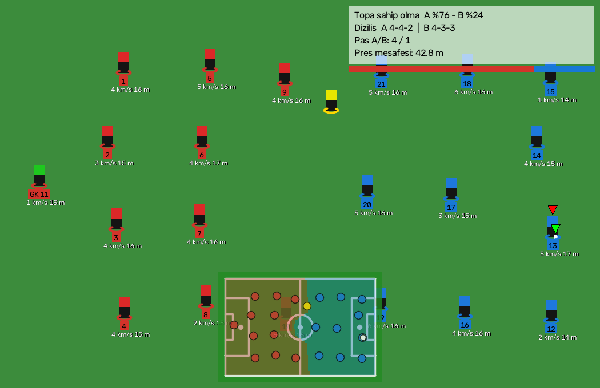
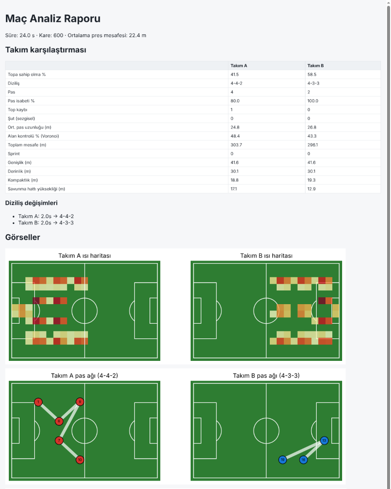

# ⚽ FutbolAnaliz

Maç videosunu (yüklenen dosya **veya canlı yayın: ekran, kamera, RTSP**) kare kare analiz eden
kompakt bir Python projesi. GitHub'daki önde gelen futbol analiz projelerinin en güçlü yanları
tek, sade bir hatta birleştirildi (~1.700 satır).



## Ne yapıyor?

| Analiz | Nasıl | Örnek alınan proje |
|---|---|---|
| Oyuncu / kaleci / hakem / top tespiti | YOLO (ultralytics) | roboflow/sports, abdullahtarek/football_analysis |
| Oyuncu takibi (sabit kimlik) | ByteTrack mantığı: yüksek+düşük güvenli iki tur eşleştirme, Macar algoritması | roboflow/sports (ByteTrack) |
| Takım ayırma | Forma göğüs bölgesi → 2 renk KMeans, köşe pikselleriyle çim atılır; kimlik başına oy çokluğu | abdullahtarek |
| Kaleci takımı | Takım merkezine yakınlık | roboflow/sports |
| Saha koordinatı (metre) | 32 anahtar noktalı saha modeli ile her karede homografi **veya** elle kalibrasyon | roboflow/sports, sn-gamestate |
| Kamera hareketi telafisi | Lucas-Kanade optik akış (oyuncular maskelenir) | abdullahtarek |
| Hız, mesafe, sprint, yüksek tempo koşu | Pencere uçları arası yer değiştirme (titreşime dayanıklı), 38 km/s üstü atılır | abdullahtarek |
| Topa sahip olma % | Topa en yakın oyuncu + "eylemsizlik" (birkaç kare onay) | tryolabs/soccer-video-analytics |
| Pas, top kaybı, pas isabeti, pas uzunluğu | Sahip değişimi: aynı takım = pas, farklı takım = top kaybı | tryolabs |
| Şut (sezgisel) | Kaleye doğru >50 km/s top; takım arkadaşına ulaşırsa iptal | — |
| **Diziliş** (4-4-2, 4-3-3, 4-2-3-1, 3-5-2, 5-3-2 …) ve diziliş değişimleri | Son 20 sn ortalama konumlar → şablonlarla Macar eşleştirmesi | SoccerCPD / EFPI makaleleri |
| Takım şekli | Genişlik, derinlik, kompaktlık, savunma hattı yüksekliği | Friends-of-Tracking |
| Alan kontrolü | Voronoi (her saha hücresi en yakın oyuncunun takımına) | roboflow/sports |
| Pres yoğunluğu | Top sahibine en yakın rakibin mesafesi | — |
| Pas ağı, ısı haritası, olay haritası | Pas sayıları + ortalama konumlar | DevaNandanJS, soccermatics |
| **Oyuncu profili** | Rol (Kaleci/Defans/Orta saha/Forvet) + bölge (sol/merkez/sağ), mesafe, maks. hız, sprint, pas, top kaybı; 0-100 puanlar: hız, dayanıklılık, yoğunluk, oyuna katılım, pas | — |
| Takip verisi CSV | Her kare, her oyuncu: piksel + metre konum, hız | SportsLabKit |
| Radar / mini harita | Videonun altına kuşbakışı saha + Voronoi | roboflow/sports |

Çıktılar: `analiz.mp4` (işaretli video), `rapor.html` (grafikli rapor), `rapor.json`, `takip.csv`.



## Windows: Tak-çalıştır (taşınabilir) sürüm

Kurulum gerekmez; Python dahil her şey tek klasörde gelir (USB bellekten de çalışır).

1. GitHub'da **Actions → "FutbolAnaliz Windows tasinabilir paket"** → son başarılı çalıştırma →
   `FutbolAnaliz_Portable_cpu` dosyasını indirin (GPU sürümü için "Run workflow" ile `cu126` seçin).
   İsterseniz kendi bilgisayarınızda da oluşturabilirsiniz: `portable\portable_olustur.bat`.
2. Zip'i çıkarın, **`BASLAT.bat`**'a çift tıklayın.
   - `WEB_ARAYUZ.bat` – tarayıcıda arayüz
   - `VIDEO_ANALIZ.bat` – videoyu üstüne sürükleyip bırakın
   - `CANLI_EKRAN.bat` – ekrandaki maç yayınını canlı analiz
   - `CANLI_YAYIN.bat` – kamera / RTSP
   - `SISTEM_KONTROL.bat` – GPU, model ve hız testi
3. Futbol modelinizi `modeller\futbol.pt`, saha modelinizi `modeller\saha.pt` olarak koyarsanız otomatik kullanılır.

Ayrıntılar: [portable/OKUBENI.txt](portable/OKUBENI.txt)

## Kurulum (geliştirici)

```bash
cd FutbolAnaliz
pip install -r requirements.txt     # GPU için önce uygun torch sürümünü kurun
```

## Modeller

1. **Oyuncu/top modeli (`--model`)** — futbola özel model şiddetle önerilir (hakem/kaleci ayrımı, küçük top tespiti).
   Roboflow Universe'teki *football-players-detection* veri setiyle (roboflow/sports'un kullandığı) eğitin:
   ```bash
   yolo detect train data=football-players-detection/data.yaml model=yolo11m.pt imgsz=1280 epochs=50
   ```
   Hiç model vermezseniz COCO modeli `yolo11m.pt` indirilir (person → oyuncu, sports ball → top); çalışır ama hakemler takımlara karışabilir.
2. **Saha anahtar noktası modeli (`--saha-model`, opsiyonel ama en iyisi)** — *football-field-detection* veri setiyle 32 noktalı YOLO-pose:
   ```bash
   yolo pose train data=football-field-detection/data.yaml model=yolo11m-pose.pt imgsz=640 epochs=100
   ```
   Nokta sırası `futbol_analiz/pitch.py` içindeki `pitch_vertices()` ile aynıdır (roboflow/sports ile uyumlu).
3. Saha modeli yoksa **elle kalibrasyon**: `python -m futbol_analiz kalibre mac.mp4` → ilk karede en az 4 saha noktasına tıklayıp numarasını yazın.
   Kamera dönerse optik akış ile telafi edilir (zoom telafi edilmez).
4. Hiçbiri yoksa: hız/mesafe oyuncu boyundan (1,8 m) ölçeklenir, radar ve taktik **yaklaşıktır** (ekranda uyarı çıkar).

Saha nokta numaraları (sol kaleden sağa, üst taç çizgisi y=0):

```
 1 ─────────────────────── 14 ─────────────────────── 25
 2 ───── 10           15 (orta yuvarlak üst)    18 ───── 26
 3 ─ 7   11                                      19   23 ─ 27
      9 (penaltı)   31   ●   32           22 (penaltı)
 4 ─ 8   12                                      20   24 ─ 28
 5 ───── 13           16 (orta yuvarlak alt)    21 ───── 29
 6 ─────────────────────── 17 ─────────────────────── 30
```

## Kullanım

```bash
# Kayıtlı video
python -m futbol_analiz analiz mac.mp4 --model futbol.pt --saha-model saha.pt --cikti sonuc/

# Canlı: ekranda açık maç yayını (tarayıcı/TV uygulaması), her 2. kare
python -m futbol_analiz canli --kaynak screen --model futbol.pt --saha-model saha.pt --adim 2 --goster
# Canlı: RTSP / kamera
python -m futbol_analiz canli --kaynak rtsp://192.168.1.10/stream --model futbol.pt
python -m futbol_analiz canli --kaynak 0 --model futbol.pt
# Ctrl+C ile durdurunca rapor yine yazılır.

# Web arayüzü (video yükle / canlı kaynak, anlık panel, indirilebilir rapor)
streamlit run app.py
```

Python'dan:

```python
from futbol_analiz.detection import YoloDetector
from futbol_analiz.pipeline import MatchAnalyzer
from futbol_analiz.sources import open_source

frames, fps = open_source("mac.mp4")
an = MatchAnalyzer(YoloDetector("futbol.pt"), fps)
for vis, res in an.run(frames):
    print(res.time_s, an.possession.possession_pct(), an.tactics.current_formation(0))
print(an.summary())
```

## Yapı

```
futbol_analiz/
  core.py         ortak veri tipleri (Detections, PlayerState, FrameResult)
  sources.py      video / kamera / RTSP / ekran yakalama
  detection.py    YOLO oyuncu-top ve saha anahtar noktası modelleri
  tracking.py     ByteTrack tarzı takip
  teams.py        forma rengiyle takım ayırma
  pitch.py        saha geometrisi, homografi, radar çizimi
  camera.py       kamera hareketi telafisi
  possession.py   sahiplik, pas, top kaybı, şut
  stats.py        hız/mesafe, oyuncu profilleri
  tactics.py      diziliş, şekil, Voronoi, pres, pas ağı, ısı haritası
  annotate.py     video üzerine çizim
  pipeline.py     hepsini birleştiren MatchAnalyzer
  report.py       HTML + JSON rapor
  kontrol.py      sistem kontrolü (GPU, modeller, hız)
app.py            Streamlit arayüzü
portable/         Windows taşınabilir paket: build_portable.ps1, başlatıcı .bat dosyaları
tests/            birim testleri + sentetik maçla uçtan uca test
```

## Testler

```bash
python -m pytest -q
```

Uçtan uca test sentetik bir maç üretir (kırmızı 4-4-2, mavi 4-3-3, 4 pas → top kaybı → 2 pas).
Hattın dizilişleri, hücum yönlerini, pas/top kaybı sayılarını, sahipliği ve oyuncu rollerini doğru bulduğunu doğrular.

## Sınırlamalar (dürüst not)

- Yayın kamerası sahanın bir kısmını gösterir; diziliş, son 20 sn'de görülen oyuncuların ortalama konumundan çıkarılır. Görüntüde 8'den az oyuncu varsa "belirsiz" der.
- Kimlikler takip kimlikleridir; oyuncu kadrajdan çıkıp girince yeni kimlik alabilir. Forma numarası okuma (sn-gamestate) eklenmedi.
- Pas/şut tespiti sezgiseldir; havadaki topun saha konumu homografiyle hatalı çıkabilir.
- Gerçek zamanlı hız GPU'ya bağlıdır: RTX 3060 sınıfında 1280 px girişte yaklaşık 15-25 kare/sn beklenir; CPU'da `--adim` ile kare atlayın.
- Oyuncu puanları bu videodaki verilerden türetilir, FIFA/SoFIFA reytingi değildir. Dış veri gerekirse `soccerdata` paketi eklenebilir.
